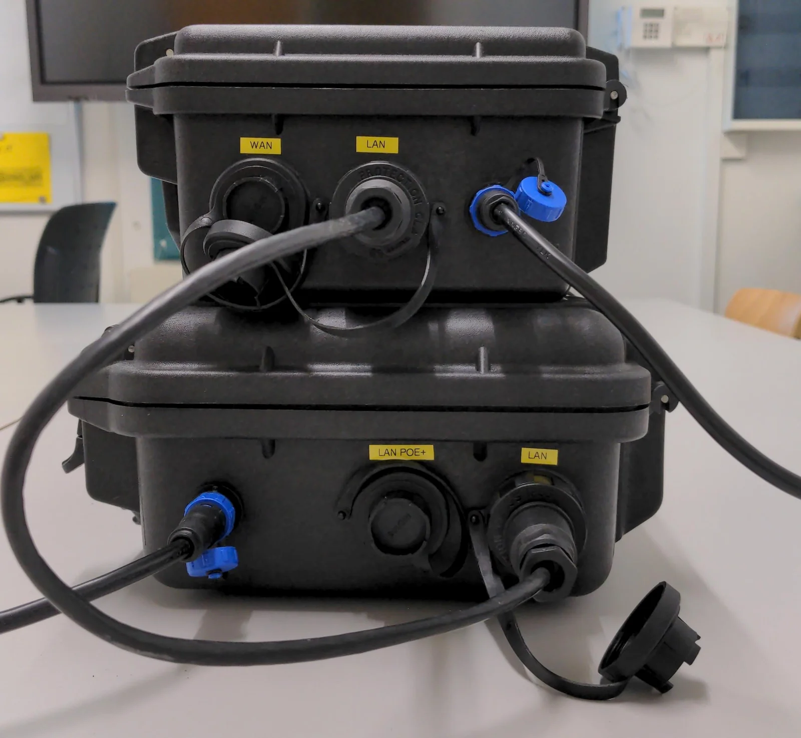
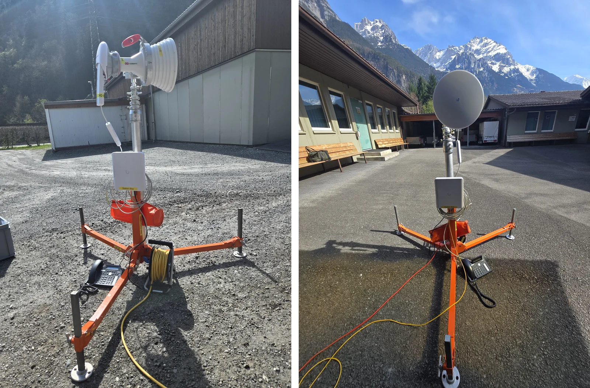
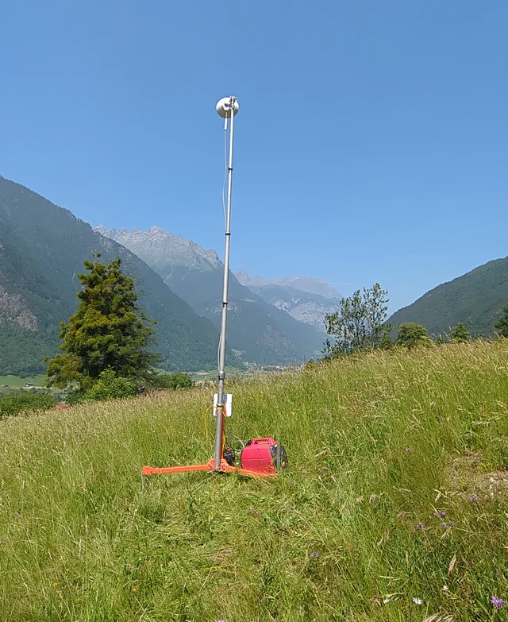

F-ELD bietet vorkonfigurierte Hardware für die Kommunikation im Einsatz an. Alle Produkte sind **vorkonfiguriert, getestet und sofort einsatzbereit**. Fragen und Offerten: [info@f-eld.ch](mailto:info@f-eld.ch)

## Warum Hardware für Führungsstäbe?

Eine Software für die Lagedarstellung hilft nur, wenn alle Beteiligten sie erreichen. sitrep läuft im Browser und braucht dafür ein Netzwerk zwischen den Arbeitsplätzen und dem Server. Im Einsatz ist dieses Netzwerk nicht selbstverständlich: Der Kommandoposten steht in einer Turnhalle, in einem Zelt oder nahe der Schadenstelle, und der Stab ist auf mehrere Standorte verteilt.

- **Verbindung herstellen:** Die WLAN-Box vernetzt die Arbeitsplätze im Kommandoposten. Die 5G-Box verbindet den Kommandoposten über das Mobilfunknetz mit dem Internet. Ein Richtstrahl-System verbindet zwei Kommandoposten (KP Rück und KP Front) über bis zu 10 km.
- **Schnell und ohne Spezialwissen:** Milizstäbe nutzen Technik selten und unter Zeitdruck. Die Geräte sind darum vorkonfiguriert und getestet, sie sollen angeschlossen werden können, ohne dass der Stab sie konfigurieren muss.
- **Robust:** Die Boxen stecken in geschützten Gehäusen (IP67) mit Schraubverbindungen, die Stationen der Richtstrahl-Systeme in wetter- und wassergeschützten Gehäusen. Sie sind für den Einsatz im Freien gebaut.
- **Vom gleichen Verein wie sitrep:** F-ELD entwickelt sitrep und liefert die Hardware dazu, mit Dokumentation und Funktionstest.

*Oben die 5G-Box mit den Anschlüssen WAN, LAN und 230-V-Einspeisung, unten die WLAN-Box mit LAN PoE+, LAN und 230-V-Einspeisung.*

## 5G-Box

Robuste und flexible Internetverbindung.

**Lieferumfang**

- 5G-Modem mit WAN- und LAN-Anschluss
- 2 externe Abgänge mit Schraubverbindung
- 230-V-Einspeisung mit Schraubverbindung
- 1 kurzes Outdoor-Netzwerkkabel mit Schraubverbindung
- IP67-geschütztes Case
- Hardware-Assembling und Konfiguration
- Funktionstest und Dokumentation

## WLAN-Box

Flexible und robuste WLAN-Verbindung.

**Lieferumfang**

- WLAN-Access-Point
- Industrieller 4-Port-PoE-Switch mit 120 Watt PoE-Budget
- 2 externe RJ45-Abgänge mit Schraubverbindung
- 230-V-Einspeisung mit Schraubverbindung
- IP67-geschütztes Gehäuse
- Hardware-Assembling und Konfiguration
- Funktionstest und Dokumentation

## Richtstrahl-Systeme

Zuverlässige Punkt-zu-Punkt-Funkverbindungen. Ein System besteht aus einer Hauptstation und einer oder mehreren Aussenstationen, dazu kommen auf Wunsch SIP-Tischtelefone.

*Links die Hauptstation (KP Rück), rechts die Aussenstation (KP Front), je mit SIP-Tischtelefon.*

### Hauptstation (KP-Rück)

Die zentrale Kommunikationseinheit.

- Basiseinheit mit 30°-Richtantenne und Halterung
- 4-Port-PoE-Switch im wassergeschützten Gehäuse
- PoE-Adapter
- 5 m Netzwerkkabel (Switch ↔ Basiseinheit)
- Hardware-Assembling und Konfiguration
- Funktionstest und Dokumentation

### Aussenstation (KP-Front)

Die zuverlässige Empfangseinheit.

- WLAN-Empfangsantenne inklusive Halterung
- 4-Port-PoE-Switch im wettergeschützten Gehäuse
- PoE-Adapter
- 5 m Netzwerkkabel (Switch ↔ Antenne)
- Hardware-Assembling und Konfiguration
- Funktionstest und Dokumentation

### SIP-Tischtelefon

Für integrierte Kommunikation.

- SIP-kompatibles Tischtelefon
- 5 m Netzwerkkabel (Switch ↔ Telefon)
- Telefonkonfiguration
- Funktionstest und Dokumentation

### Systemaufbau

Zwischen Basisstation und Remotestation besteht eine Richtstrahl-Verbindung über bis zu 10 km Distanz. An beiden Stationen lassen sich Laptops und SIP-Telefone anschliessen. Optional:

- Internetanbindung der Basisstation via Satellit oder 4G/5G
- mehrere Remotestationen zu einer Basisstation

*Eine Station im Einsatz an einem abgelegenen Standort: ausgefahrener Mast mit Antenne auf dem Dreibein, daneben ein Stromaggregat.*

## Ihre Vorteile

- **Sofort einsatzbereit:** komplett vorkonfiguriert und getestet
- **Einfache Installation:** intuitive Montage, minimaler Aufwand
- **Robuste Qualität:** bewährte Komponenten für den Langzeitbetrieb
- **Umfangreiche Dokumentation:** alle technischen Unterlagen
- **Wirtschaftlich:** gutes Preis-Leistungs-Verhältnis
- **Wartungsfreundlich:** modularer Aufbau für einfache Reparaturen
- **Skalierbar:** leicht erweiterbar mit zusätzlichen Stationen
